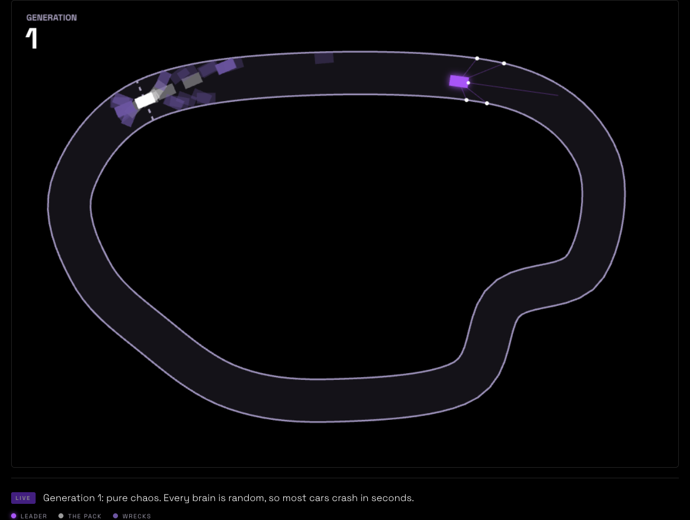
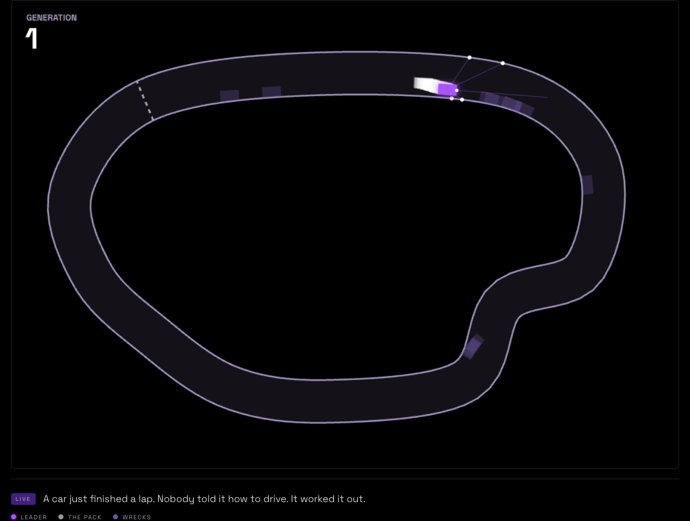
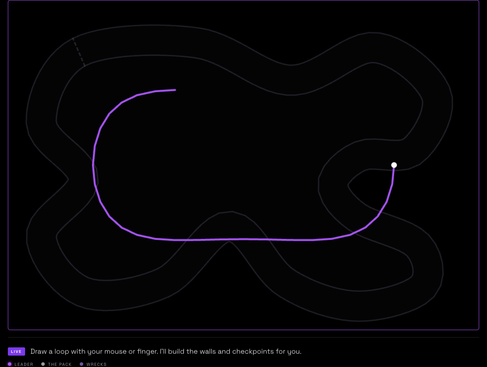
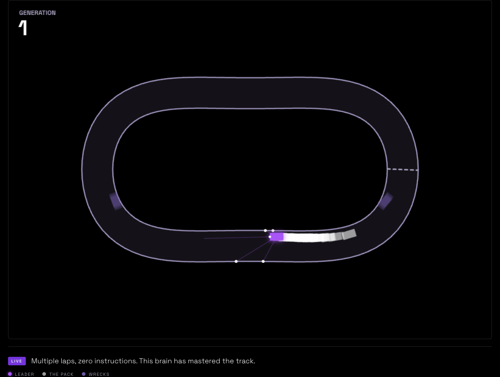
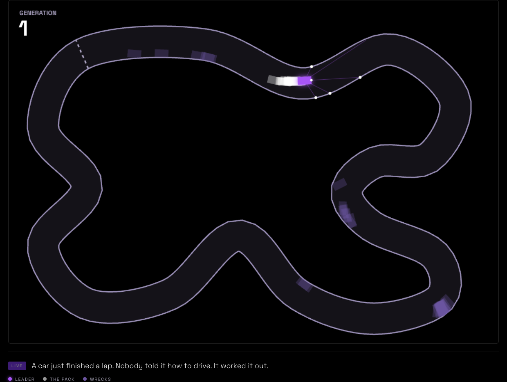
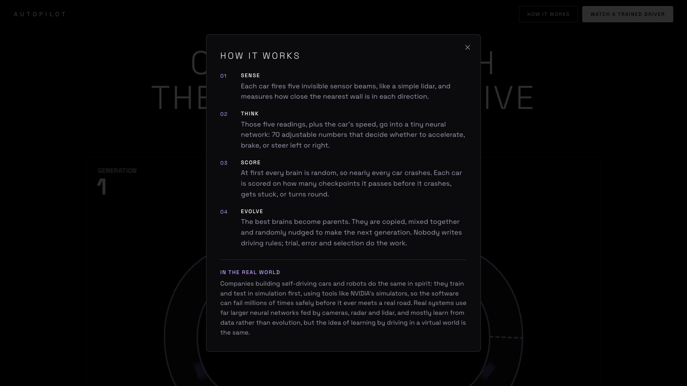
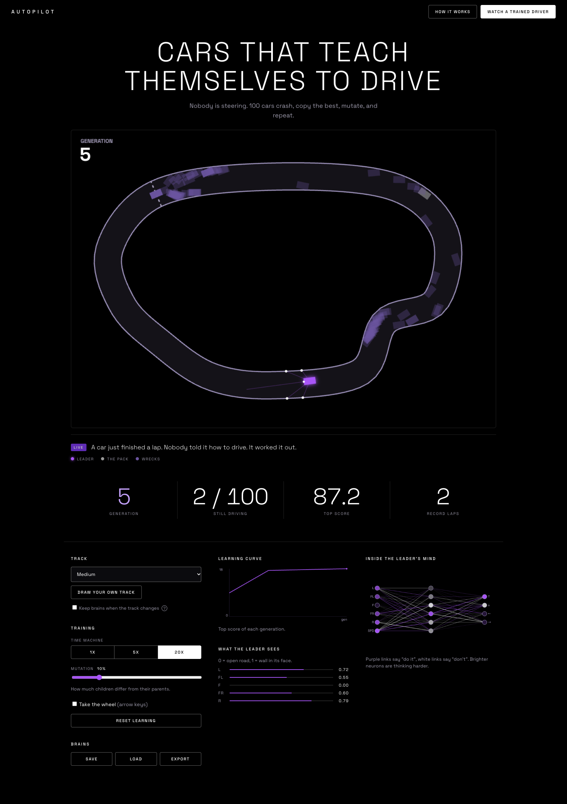
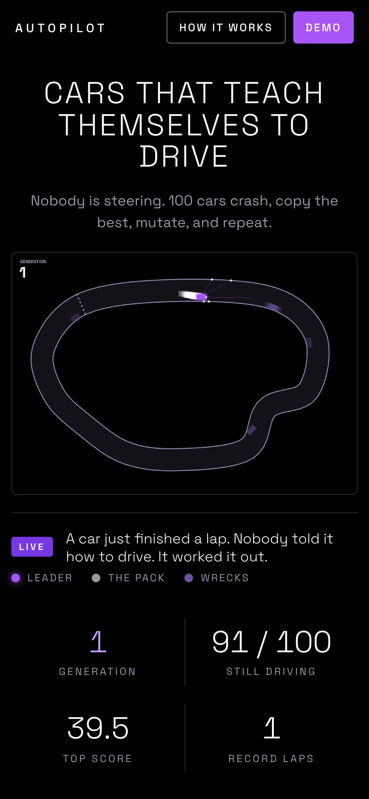
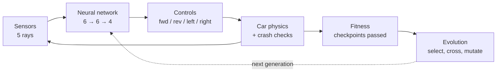

<div align="center">

# Autopilot

**100 simulated cars teach themselves to drive: a neural network and evolution, written from scratch in plain JavaScript.**

[](https://github.com/aluinn/Autopilot-self-driving-cars/actions/workflows/ci.yml)
[](https://github.com/aluinn/Autopilot-self-driving-cars/actions/workflows/codeql.yml)
[](LICENSE)
[](https://github.com/aluinn/Autopilot-self-driving-cars/stargazers)
[](https://vercel.com/new/clone?repository-url=https://github.com/aluinn/Autopilot-self-driving-cars)

https://github.com/user-attachments/assets/de0f70c0-36ed-484e-b652-33bd68b68beb

[Deploy](#deploy) · [Architecture](docs/ARCHITECTURE.md) · [Roadmap](ROADMAP.md) · [Contributing](CONTRIBUTING.md)

**[▶ Live demo](https://autopilot-one-iota.vercel.app)**

</div>

## Features

- **Neuroevolution from scratch.** A feed-forward neural network (6 → 6 → 4, 70 weights and biases) and a genetic algorithm, with no ML library, framework or build step.
- **100 cars per generation** that crash, get scored, and breed: elitism (top 5 kept), fitness-weighted selection from the top quarter, crossover and mutation.
- **Lidar-style sensing.** Five rays across about 120° measure the distance to the nearest wall using line-segment intersection.
- **Three preset tracks** (Easy, Medium, Hard) **and draw-your-own**: sketch a loop with a mouse or finger and walls and checkpoints are generated, with friendly messages if the track is unusable (too small, too tight, crossing itself).
- **Generalisation test.** Tick "Keep brains when the track changes" to drop the current drivers onto a new road and see whether what they learned transfers.
- **Look inside the brain.** A live learning curve, the leader's five sensor readings, and a network diagram where neurons and links light up as they fire.
- **Time machine.** Run 1×, 5× or 20× simulation steps per frame, and tune the mutation rate from 0% to 50%.
- **Take the wheel.** Drive a car yourself with the arrow keys (on-screen arrows on touch devices).
- **Pre-trained demo driver**, trained across all three presets by [`tools/train-demo.js`](tools/train-demo.js).
- **Save, load and export brains** to browser storage or a JSON file.
- **Responsive**, with a phone layout.

## Screenshots

<table>
  <tr>
    <td><br><sub><b>Generation 1:</b> random brains, mostly crashing</sub></td>
    <td><br><sub><b>The demo driver:</b> a trained brain completing laps</sub></td>
  </tr>
  <tr>
    <td><br><sub><b>Draw your own track:</b> one stroke, the old track faintly behind</sub></td>
    <td><br><sub><b>Generalising:</b> the same drivers on the track you drew</sub></td>
  </tr>
</table>

<details>
<summary>More screenshots</summary>

| | |
|---|---|
| <br><sub>The Hard track (S-bends and a hairpin)</sub> | <br><sub>The built-in "How it works" pop-up</sub> |
| <br><sub>Evolving from scratch: generation 5 in this capture, first lap done, with the lab panels below</sub> | <br><sub>Phone layout (390×844)</sub> |

</details>

## How it works



1. **Sensing.** Each car fires 5 rays across about 120° ([`sensor.js`](sensor.js)). Each returns 0 (nothing within 150 px) to 1 (wall touching).
2. **Thinking.** The 5 readings plus the car's speed feed the network ([`network.js`](network.js)). Every output above zero presses a key: forward, reverse, left, right. The 70 weights and biases are the car's entire personality.
3. **Scoring.** Fitness is checkpoints passed (across laps), plus progress to the next one, plus a small speed bonus ([`car.js`](car.js)). A car is retired if it hits a wall, crosses the previous checkpoint backwards, or goes about 3 seconds without a new checkpoint.
4. **Evolving.** When everyone has stopped or 2400 ticks have passed, the top 5 brains are copied unchanged, and the rest of the next generation is bred from the top quarter ([`evolution.js`](evolution.js)). Repeat.

The longer version, with sequence diagrams and a failure-modes table, is in [docs/ARCHITECTURE.md](docs/ARCHITECTURE.md).

## Quick start

There is nothing to install to run the app. It is a static site.

```bash
git clone https://github.com/aluinn/Autopilot-self-driving-cars.git
cd Autopilot-self-driving-cars
python3 -m http.server 8000   # any static file server works
# then open http://localhost:8000
```

Or open the folder in VS Code and use the **Live Server** extension on `index.html`.

| Command | What it does |
|---|---|
| `npm start` | Serve the app at `http://localhost:8000` (no dependencies; `python3 -m http.server` works too) |
| `npm run lint` | Syntax, whitespace and `index.html` reference checks |
| `npm test` | Unit tests (Node's built-in runner) |
| `npm run e2e` | End-to-end smoke test in a real browser (`npx playwright install chromium` once) |
| `npm run bench` | Simulation benchmark, see [docs/PERFORMANCE.md](docs/PERFORMANCE.md) |
| `npm run train-demo` | Re-train the demo brain (headless, rewrites `demo.js`) |
| `npm run screenshots` | Regenerate the screenshots in `docs/assets/` |

`npm run e2e` and `npm run screenshots` (and the browser half of `npm run bench`) need `npm install`; Playwright is the only dev dependency. The rest run on plain Node 20+.

## Deploy

It is a static site with no build command, so any static host works.

- **Vercel:** [one-click deploy](https://vercel.com/new/clone?repository-url=https://github.com/aluinn/Autopilot-self-driving-cars). Framework preset "Other", no build command, output directory left blank.
- **Netlify / GitHub Pages / Cloudflare Pages:** publish the repository root as-is.

## FAQ

**Is this reinforcement learning?**
No. It is neuroevolution: there is no gradient, no backpropagation and no reward signal during a drive. Brains are scored after the fact and selected.

**How long does it take to learn?** It varies a lot, because everything starts random. In two headless runs on the Medium track at 20×, the first car completed a lap at generation 5 in one run and generation 22 in the other. A single run proves nothing, so treat these as a feel for the range, not a benchmark.

**Why does the demo driver sometimes crash on a track I drew?**
It was trained only on the three presets ([`tools/train-demo.js`](tools/train-demo.js)). It generalises to some drawn tracks and not others, which is the point of the "Keep brains" experiment.

**Are runs reproducible?**
No. Initial weights, selection, crossover and mutation all use `Math.random()`. A seeded generator is a [good idea for an issue](docs/issues/06-seeded-rng.md).

**Does it work offline?**
Almost. The page loads the Space Grotesk font from Google Fonts; without network it falls back to a default font and everything else still works.

**Does it use a lot of CPU?**
At 20× the page runs 20 simulation steps per frame on the main thread, which can drop the frame rate on slow machines. I haven't profiled it, and moving the simulation to a Web Worker is an [open idea](docs/issues/09-web-worker-training.md).

**Is the "real world" comparison fair?**
It is a metaphor. Real self-driving stacks use far larger models, camera/radar/lidar and mostly learn from data. This project is a teaching toy.

## Good first issues

Drafts live in [`docs/issues/`](docs/issues) (copy one into a new GitHub issue).

| Issue | Where to look |
|---|---|
| [Narrator says "pure chaos" after loading a trained brain](docs/issues/01-narrator-after-demo.md) | `main.js` |
| [Import a brain from a JSON file](docs/issues/02-import-brain-json.md) | `main.js`, `index.html` |
| [Add a pause button](docs/issues/03-pause-button.md) | `main.js`, `index.html` |
| [Self-host the Space Grotesk font](docs/issues/04-self-host-font.md) | `index.html`, `style.css` |
| [Remember the track you drew](docs/issues/05-persist-custom-track.md) | `main.js` |

More in [docs/issues/](docs/issues) (enhancements such as seeded runs, shareable track links and a Web Worker).

## Roadmap

See [ROADMAP.md](ROADMAP.md).

## Credits

- Built by **Aluinn McDonald**.
- Font: [Space Grotesk](https://fonts.google.com/specimen/Space+Grotesk) (SIL Open Font License), served by Google Fonts.
- Track curves use a [Catmull-Rom spline](https://en.wikipedia.org/wiki/Centripetal_Catmull%E2%80%93Rom_spline).
- Screenshots are captured with [Playwright](https://playwright.dev/).
- No runtime libraries: the neural network, genetic algorithm, physics and charts are hand-written.

## License

[MIT](LICENSE) © Aluinn McDonald
