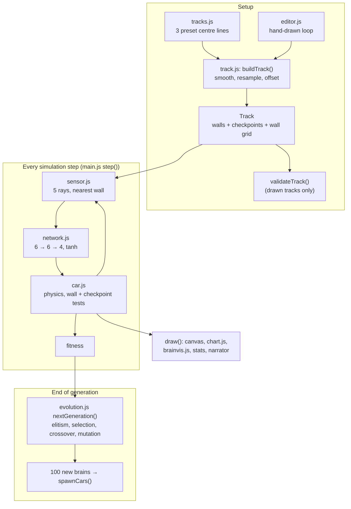

# Architecture

Autopilot is a static site: `index.html` loads 13 plain scripts in order, and each defines
globals the next ones use. There is no bundler, no module system and no server. This page
explains how the pieces fit, why a few things are done the way they are, and what can go wrong.

## Data flow



## One generation, in sequence

```mermaid
sequenceDiagram
    participant L as frame() loop
    participant M as main.js step()
    participant C as Car (x100)
    participant S as Sensor
    participant N as NeuralNetwork
    participant E as evolution.js
    loop stepsPerFrame times (1, 5 or 20)
        L->>M: step()
        M->>C: update(controls, track)
        C->>N: think(): feedForward([5 readings, speed])
        N-->>C: 4 outputs; above 0 means key pressed
        C->>C: move, then hitsWall()? checkpoint? stuck?
        C->>S: update(track): 5 ray casts
    end
    L->>M: draw()
    Note over M: when all cars have stopped, or 2400 ticks have passed
    M->>E: nextGeneration(cars, 100, mutationRate)
    E-->>M: 100 brains (5 elite copies + 95 bred)
    M->>C: spawnCars(brains): all back on the start line
```

## Decisions and trade-offs

**Global scripts instead of ES modules.** The project is meant to be read top to bottom by
a beginner and run by opening a folder, so there is no build step and no module graph. The cost is that
files depend on load order (`index.html` has a comment saying so) and that Node can't `require` them. The
unit tests and `tools/train-demo.js` load the same source files through Node's `vm` module instead of
changing the code. A subtlety found while benchmarking: a `vm.createContext` sandbox runs this code about
9× slower than the real runtime (see [PERFORMANCE.md](PERFORMANCE.md)), so the benchmark and the trainer use `runInThisContext`, and only the
unit tests (which care about correctness, not speed) use the sandbox so they can seed `Math.random`.

**Checkpoints, not distance, define progress.** Fitness counts invisible lines drawn across the road
([`track.js`](../track.js)), plus fractional progress to the next one. This does two jobs at once: it rewards
going round the track in the right direction, and crossing the *previous* checkpoint backwards gives a cheap
"driving the wrong way" kill rule. Plain distance travelled would reward spinning in circles. See
[TRAINING.md](TRAINING.md) for the fitness formula.

**A spatial grid for walls.** Every car and every ray needs "which walls are near me?". Testing every segment is
simple but costly: on the Medium track with 100 demo-driven cars the grid made a simulation step about 4.3× faster
than testing all 264 wall segments (measured; see [PERFORMANCE.md](PERFORMANCE.md)). The grid is 80 px cells; `track.query()` returns a reused array
and uses a per-segment "stamp" to skip duplicates without allocating, so the result must be used immediately and never kept.

**Elitism plus selection from the top quarter.** The top 5 brains are copied unchanged so progress is never lost; other
parents are drawn from the top 25% by roulette (fitness-weighted), and half of the children are crossovers. This is a
standard, easy-to-explain recipe. The trade-off is reduced diversity: strong selection can converge on one lineage, which is
why mutation is exposed as a slider.

**Ticks, not seconds.** The simulation advances a fixed amount per call to `step()` with no delta-time, and
`frame()` calls it `stepsPerFrame` times per `requestAnimationFrame`. That makes the physics deterministic apart from
`Math.random` (so "20×" is just 20 steps per frame, and the headless trainer is the same code), at the cost of
simulation speed being tied to the display's refresh rate (read from the code, not measured).

**Brain size is tiny on purpose.** 70 numbers keep the network drawable (`brainvis.js`) and fast to evolve; it is also why
it can't do anything subtle (see the FAQ in the README).

**Generalisation is a feature, not a promise.** "Keep brains when the track changes" exists to let you watch whether
a brain generalises. The demo brain was trained on the three presets only ([TRAINING.md](TRAINING.md)).

## Failure modes

| What goes wrong | What happens | Where handled |
|---|---|---|
| A car hits a wall | Marked `crashed`, stopped for good, drawn dim | `Car.hitsWall` / `update` |
| A car drives backwards (crosses the previous checkpoint the wrong way) | Killed | `Car.trackProgress` |
| A car stalls, spins, or dawdles | No new checkpoint for 180 ticks (about 3 s at 60 ticks/s): killed | `Car.trackProgress` |
| Cars survive for a long time | The generation ends at 2400 ticks regardless | `GENERATION_TICKS` in `main.js` |
| Every car is dead early | The generation ends immediately | `step()` in `main.js` |
| Mutation 0% | Children are exact clones; narrator says so | `narration()` |
| Mutation very high | Children barely resemble their parents; narrator says so | `narration()` |
| Drawn loop too small / too long / near the edge / too tight / self-crossing | Friendly message; the old track stays | `validateTrack`, `TrackEditor.up` |
| Stroke too short (under 10 points) | "Draw a longer line" | `TrackEditor.up` |
| Saved brain is corrupt, or the shape is wrong | `fromJSON` throws; "That saved brain looks corrupted." | `Load` handler, `NeuralNetwork.fromJSON` |
| Browser blocks localStorage | "Couldn't save: this browser is blocking storage." | `Save` handler |
| Save or Export while driving manually | Asks you to switch off manual drive (humans have no brain) | `bestBrain()` |
| Google Fonts unreachable | Falls back to the system sans-serif; everything else works | `index.html`, canvas fonts |
| Demo brain on a very different drawn track | Can crash (it was trained on three presets). Not measured for arbitrary tracks | by design |
| Tab in the background | Browsers throttle `requestAnimationFrame`, so the simulation slows or pauses with it | browser behaviour, not handled |
| Very slow machine at 20× | Each frame does 20 steps on the main thread; frame rate can drop | not handled; see [issue 09](issues/09-web-worker-training.md) |

## Folder map

```
index.html, style.css      The page and its look
theme.js                   Every canvas colour in one place
utils.js                   Line-segment intersection and lerp
track.js                   Spline smoothing, wall/checkpoint generation, wall grid, validateTrack, drawTrack
tracks.js                  The three preset centre lines
editor.js                  Draw-your-own-track tool (pointer events)
sensor.js                  The 5 rays and their readings
network.js                 Layer + NeuralNetwork: forward, clone, mutate, crossover, to/from JSON
car.js                     Physics, collisions, checkpoints, fitness, drawing
evolution.js              nextGeneration(): elitism, selection, crossover, mutation
chart.js, brainvis.js     Learning-curve chart and live network visualiser
demo.js                    Pre-trained brain (generated by tools/train-demo.js, do not edit)
main.js                    State, game loop, generations, buttons, narrator
tools/                     serve.js, train-demo.js, screenshots.js, benchmark.js, lint.js
test/                      core.test.js (unit), e2e.test.js (Playwright), helpers.js (sandbox loader)
docs/                      This documentation, screenshots (docs/assets) and issue drafts (docs/issues)
.github/                   CI, CodeQL, Dependabot, issue and PR templates
```
